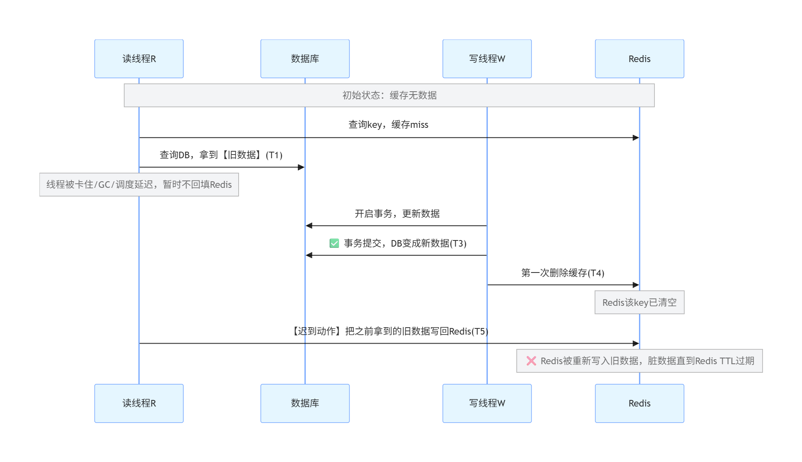
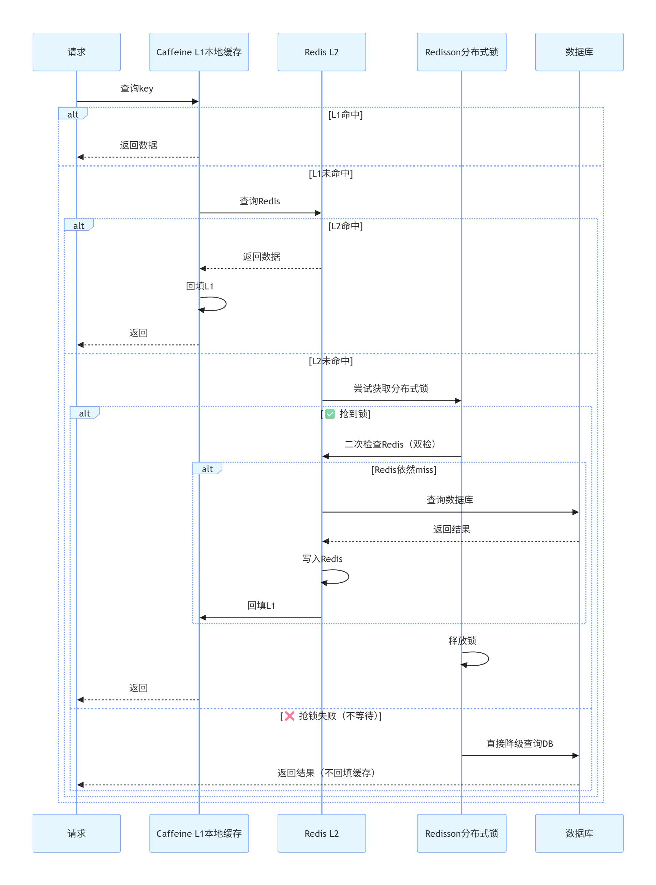
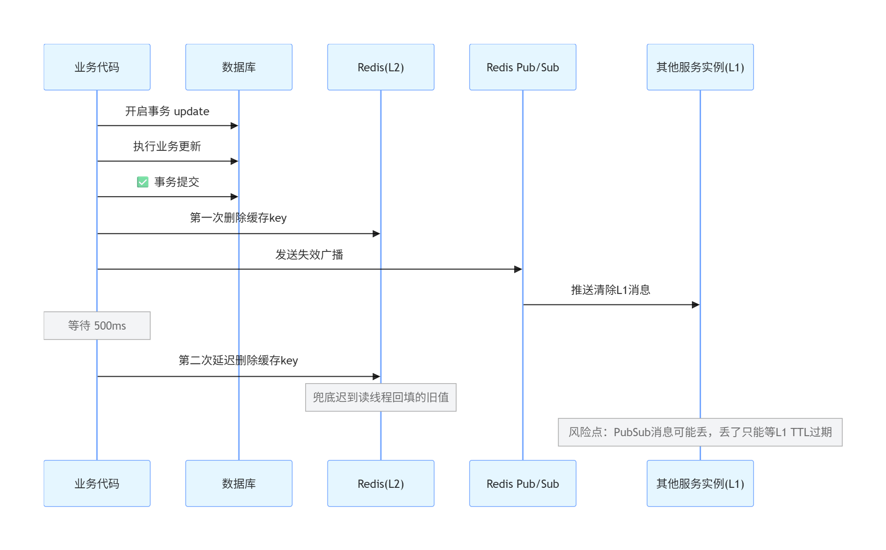
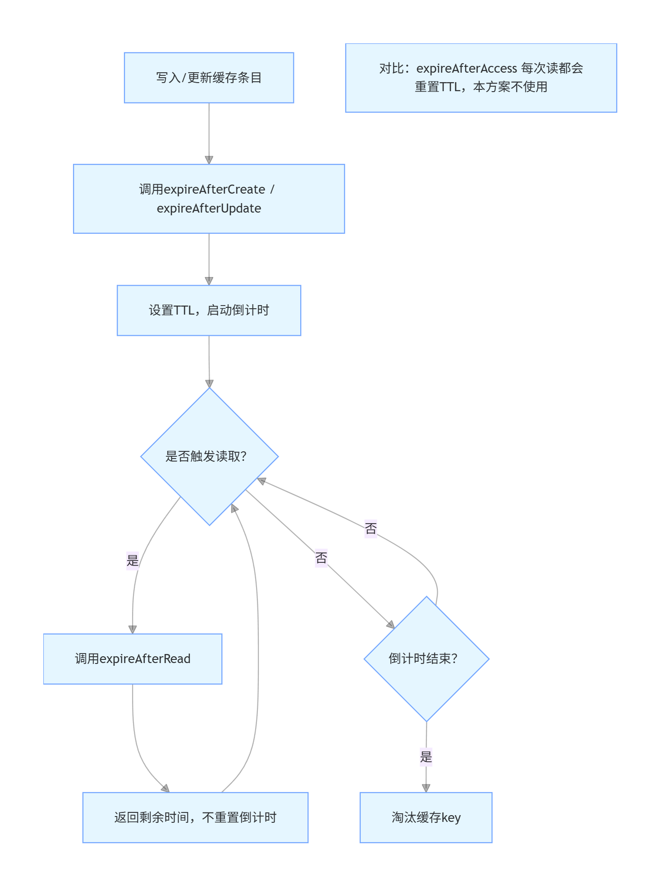
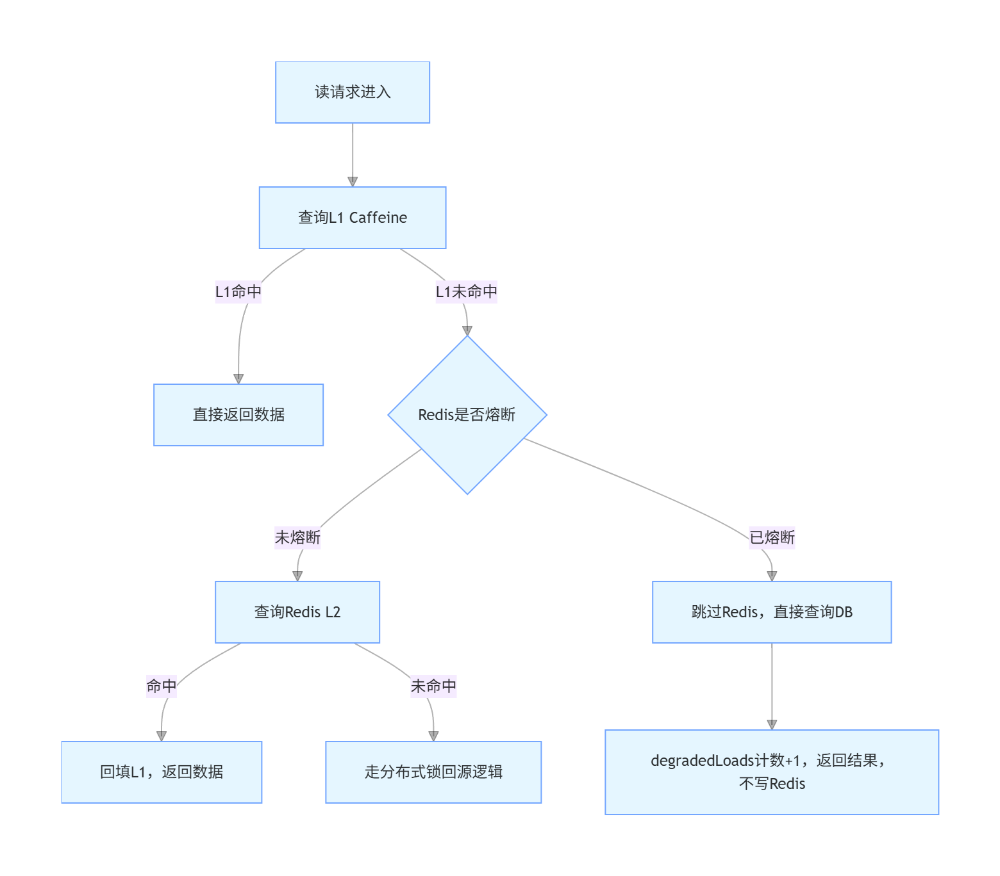
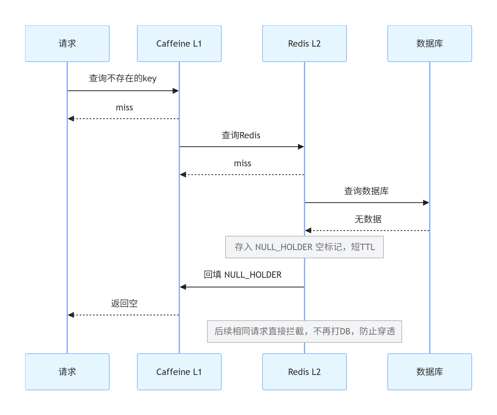

图1：竞态漏洞-没有延迟双删，脏数据产生时序

图 2：延迟双删修复竞态时序

图 3：多级缓存读完整时序（L1 Caffeine + L2 Redis + Redisson 锁 + 降级）

图 4：写操作全链路时序（事务、广播、延迟双删，独立一张）

图 5：Caffeine Expiry 过期策略（读不续期）

图 6 Redis 故障熔断降级流程图

图 7：缓存穿透防护时序（空值 NULL_HOLDER）

二级缓存业务流程：
【写流程】
1. ProductService.updatePrice(123, 99.9)
   └─ productMapper.update(...)              // 改数据库
   └─ cache.evictAfterCommit(CacheKeys.productDetail(123))
                                              ↑ CacheKeys 出场：生成 "product:detail:123"

2. 事务提交后，MultiLevelCache.evict("product:detail:123")
   ├─ localCache.invalidate(...)             // 清 A 自己的 L1
   ├─ stringRedisTemplate.delete(...)        // 删 Redis 里的 L2
   │    └─ 删除前，值是被 CacheJsonCodec 编码的 JSON
   └─ publishInvalidation("product:detail:123")   // 往 Redis 频道发消息
        └─ CacheConfig 注册的监听容器在 B、C 机器上收到
             └─ CacheInvalidationListener.onMessage(key)
                  └─ cache.evictLocal(key)   // B、C 清自己的 L1
   └─ scheduleSecondEviction(...)            // 500ms 后再删一次（CacheConfig 提供的线程池执行）

【读流程】（B 机器上的用户刷新页面）
3. ProductService.getDetail(123)
   └─ cache.getOrLoad(
        CacheKeys.productDetail(123),        // "product:detail:123"
        new TypeReference<ProductDetailVO>(){},
        () -> loadFromDb(123),
        CachePolicy.of(30, 300)              // L1 30秒，L2 300秒
      )

4. getOrLoad 内部：
   ├─ localCache.getIfPresent("product:detail:123")   // 查 B 自己的 L1
   │    └─ 命中 → 返回（如果 B 之前收到广播清过，这里就是未命中）
   ├─ 未命中 → readRemote → CacheJsonCodec.decode(...) // 查 L2
   │    └─ 命中 → 回填 L1 → 返回
   ├─ 未命中 → RedissonLockManager.tryLock(...)        // 抢锁
   │    ├─ 抢到 → 查库 → writeThrough（Codec.encode 写 L2，putLocal 写 L1）
   │    └─ 没抢到 → 直接查库，不写缓存（降级）
   └─ 返回结果